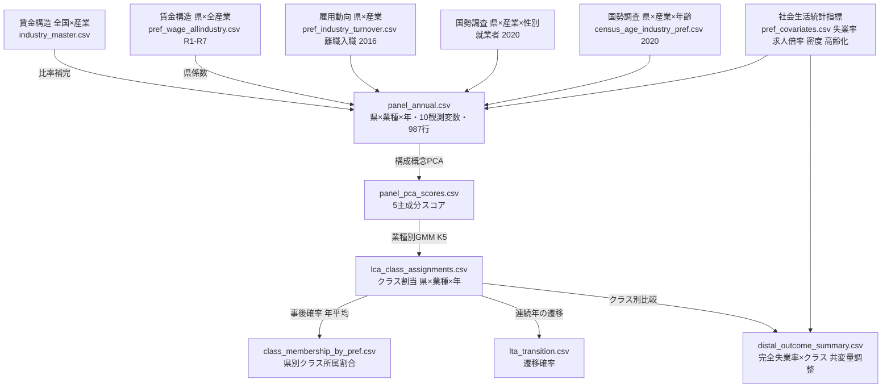
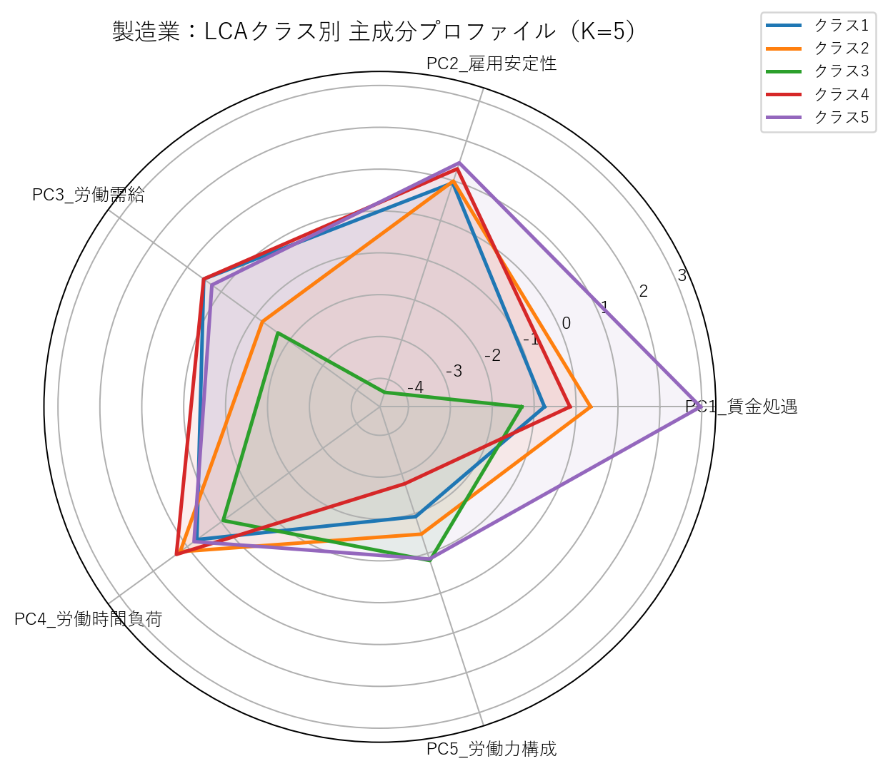
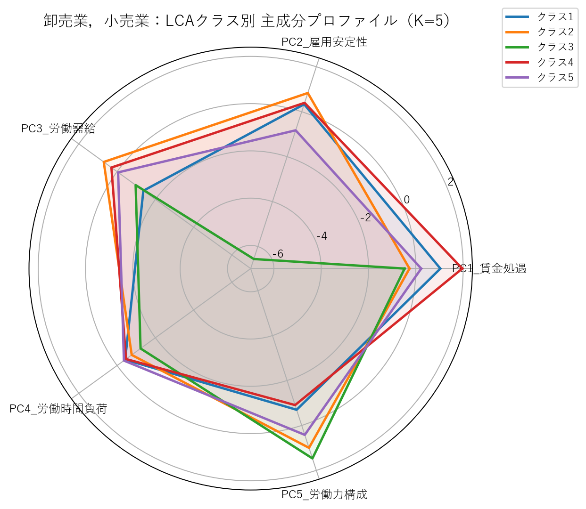
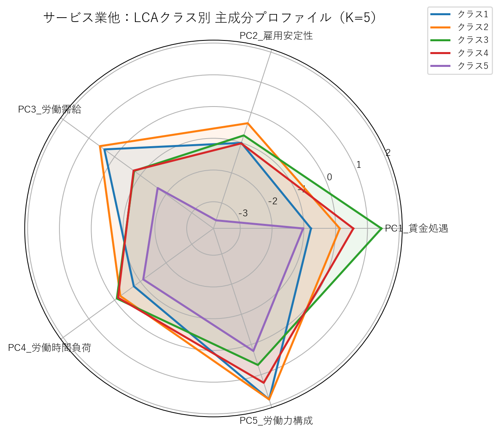
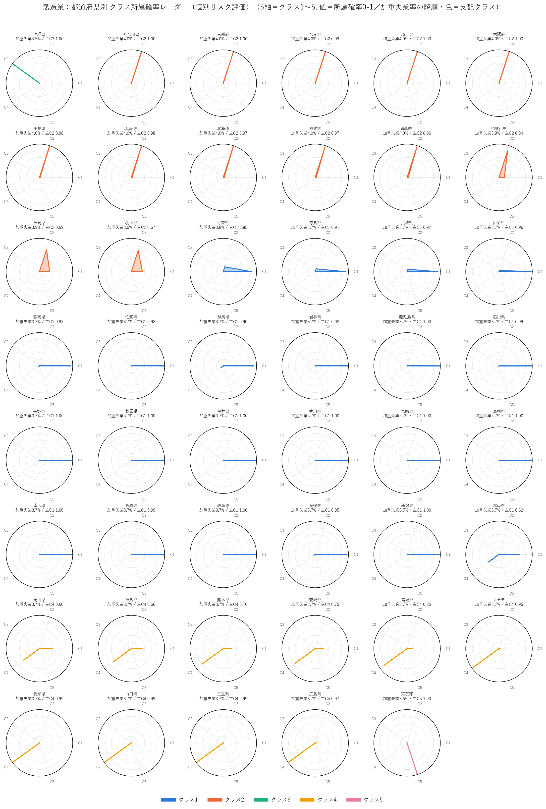
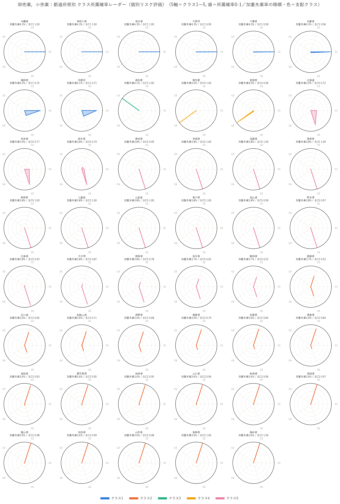
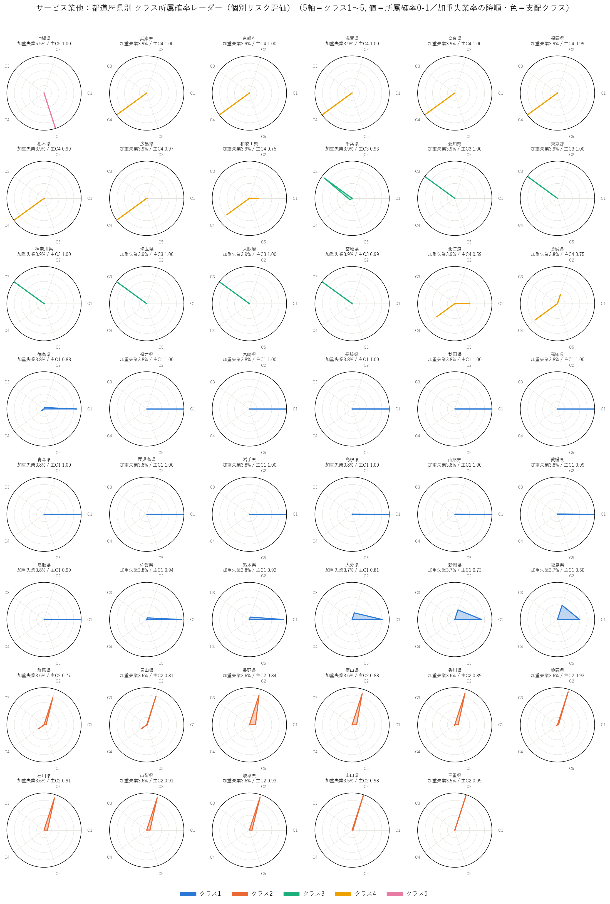

# 分析結果まとめレポート（業種別LCA再設計版）

> [要件定義書.md](要件定義書.md) / [方針書_業種別LCA再設計.md](方針書_業種別LCA再設計.md) に基づく実行結果のまとめ。SSDSE論文の素材版。
> 構成：**① 背景・目的 → ② 実行結果 → ③ 解釈 → ④ 限界 → ⑤ ネクストアクション**。
> 実行日: 2026-07-23。データはすべて公的統計（e-Stat）をWeb取得。実行ログの詳細は [実行結果報告書_改訂版要件定義書.md](実行結果報告書_改訂版要件定義書.md)。

---

## ① 背景・目的

完全失業率を「業種の労働特性」から捉え直し、**都道府県×年を分析単位**として、ターゲット3業種（製造業／卸売業，小売業／サービス業他）ごとに労働市場の**「型（潜在クラス）」**を抽出する。

- **問い**：都道府県の労働市場は、業種の中でどんな「型」に分かれ、その型は時間的に安定しているか。型は完全失業率と関連するか。
- **狙い**：型の地理分布・時間遷移（LTA）・完全失業率との調整済み関連を示し、「業種×地域タイプを特定した雇用対策」の検討材料にする。
- **旧設計からの再設計**：旧＝全国×業種・81レコード・クラス分離が弱かった（相対エントロピー0.08）。本設計＝都道府県×年で**987行**に拡張し、構成概念PCA→業種別LCA→LTA→distal の一貫パイプラインに刷新（分離0.86〜0.92へ改善）。

> **用語：「型（潜在クラス, latent class）」とは（端折らない定義）**
> 本稿の「型」とは、**潜在クラス分析（Latent Class Analysis／本実装は連続主成分に対するガウス混合＝潜在プロファイル分析）が推定する、直接は観測されない部分集団（subpopulation）**を指す。5つの労働特性主成分（賃金処遇・雇用安定性・労働需給・労働時間負荷・労働力構成）のパターンが互いに類似する 都道府県×年 を、統計モデルが確率的にまとめたグループである。
> 重要な性質として、各 都道府県×年 は**単一の型に決め打ちされるのではなく、「どの型にどれだけ属するか」を表す所属確率（事後確率, K個の型で合計1）をもつ確率分布**として表現される。型は「その部分集団に典型的な主成分プロファイル（レーダーの形）」で特徴づけられる。
> したがって「業種の中の型を抽出する」とは、**業種ごとに、都道府県×年の労働市場をこの潜在クラス（型）へ確率的に分類する**ことを意味する。参照論文も、潜在クラス分析で得た**所属確率に基づいて対象単位ごとの個別リスク評価**を行っており、本稿は同じ枠組みを都道府県の完全失業率に適用する（2.5）。

---

## ② 実行結果

### 2.1 使用データとデータリネージ

**実際に使用したデータ（すべてe-Stat・Web直取得）**

| 構成概念/用途 | 観測変数 | 出典 | 粒度 |
|---|---|---|---|
| 賃金処遇/労働時間/雇用安定 | 所定内給与額・勤続年数・超過実労働時間数 | 賃金構造基本統計（全国×産業）× 都道府県別（全産業, 令和1-7）で**比率補完**（下記） | 県×産業×年(2019-2025) |
| 雇用の安定 | 離職率・入職率 | 雇用動向調査 表5/表2 | 県×産業(2016) |
| 労働力構成 | 女性比率・就業シェア | 国勢調査 産業×都道府県 | 県×産業(2020) |
| 労働力構成 | 高齢就業比率・若年就業比率 | 国勢調査 年齢×産業×都道府県 | 県×産業(2020) |
| 労働需給/共変量 | 有効求人倍率・人口密度・高齢化率 | 社会生活統計指標 | 県(2020/2022) |
| distal | 完全失業率（県レベル） | 社会生活統計指標 F労働 | 県(2020) |

#### 前処理で行った比率補完（対象・目的・式）
- **対象データ**：賃金構造基本統計の3変数＝**所定内給与額・勤続年数・超過実労働時間数**。
- **なぜ必要か（目的）**：賃金構造基本統計は「**全国×産業**」と「**都道府県×全産業**」は公表するが、本分析が必要とする「**都道府県×産業**」のクロス集計は公表されない。分析単位が都道府県×産業×年のため、この3変数の県×産業セルを埋める必要がある。
- **どう埋めたか**：「産業間の相対差は全国と同じ」という仮定のもと、全国×産業の値に、その県の全産業水準が全国の全産業水準の何倍かという**県係数**を掛けて県×産業を推定した（[build_panel.py](../scripts/preprocess/build_panel.py)）。

  ```
  県×産業×年 ＝ 全国×産業×年 × ( 県・全産業×年 ÷ 全国・全産業×年 )
                              └────────── 県係数（県の賃金水準の高低） ──────────┘
  ```
- この補完の妥当性は§④限界1で検証する。

#### データリネージ（生データ → 中間テーブル → 最終パネル → モデル）


上図が表示されない環境向けに文章でも示す：
**① 生データ（e-Stat）**＝賃金構造(全国×産業/県×全産業)・雇用動向(県×産業)・国勢調査(県×産業×性別/年齢)・社会生活統計指標(県)。
**→ ② 中間テーブル**＝比率補完で作った県×産業×年の賃金3変数＋県×産業の就業構成/離職入職＋県の共変量。
**→ ③ 最終パネル** `panel_annual.csv`（県×業種×年・10観測変数・987行）。
**→ ④ モデル**＝構成概念PCA(5主成分) → 業種別LCA(K=5クラス) → そこから「LTA(遷移確率)」「県別クラス所属割合」「distal(完全失業率との関連)」を分岐生成。

- **規模**：パネル**987行**（47都道府県×3業種×年2019-2025）、欠損0%。LCA投入は**329レコード/業種**。観測変数は**10**（設計25のうち県×産業で取得できたもの。§④限界2）。

#### 最終アウトプットテーブルの仕様（列・型・サンプル数）

**① パネル `panel_annual.csv`（構成概念PCAへの入力）**
| 列 | 役割 | 型 |
|---|---|---|
| prefecture / industry / year | キー | 文字列(47県) / 文字列(3業種) / 整数(2019-2025) |
| 所定内給与額・勤続年数・超過実労働時間数・女性比率・就業シェア・高齢就業者比率・若年就業者比率・離職率・入職率・有効求人倍率 | 観測変数(10) | 連続値（標準化前） |
| 人口密度・高齢化率・完全失業率 | 共変量・distal | 連続値（県レベル） |
| wage_year | 賃金の補完年フラグ | 整数 |
- サンプル数：**987**（47×3×7）、欠損0%。

**② LCAクラス割当 `lca_class_assignments.csv`**
| 列 | 内容 | 型 |
|---|---|---|
| prefecture / industry / year | キー | 文字列 / 文字列 / 整数 |
| class | LCAクラス(K=5) | 整数 1〜5 |
| post_max | 事後確率の最大値 | 実数 [0,1] |
- サンプル数：**329/業種**（都道府県×年）。

**③ 県別クラス所属確率 `class_membership_by_pref.csv`（個別リスク評価, §2.5）**
| 列 | 内容 | 型 |
|---|---|---|
| industry / prefecture | キー | 文字列 / 文字列 |
| p1〜p5 | 各クラスへの所属確率（年平均・合計1） | 実数 [0,1] |
| 支配クラス / 支配割合 | 確率最大の型とその確率 | 整数 / 実数 [0,1] |
| 加重失業率 | Σ(所属確率 × クラス失業率)＝個別リスク | 実数(%) |
- サンプル数：**47/業種**（都道府県）。

### 2.2 構成概念PCA（5構成概念 → 5主成分）

構成概念ごとに観測変数を標準化し第1主成分に丸めた（[construct_pca.py](../scripts/model/construct_pca.py)、`pca_loadings.csv`）。**各主成分がどの観測変数でどの割合で構成されているか**を、負荷量の二乗を100%換算した「構成比」で示す（第1主成分の分散に対する各変数の寄与）。

| 主成分 | 観測変数（符号） | 構成比（loading²換算） | 第1主成分寄与率(EVR) |
|---|---|---|---|
| PC1 賃金処遇 | 所定内給与額(+) | 100% | 1.00 |
| PC2 雇用安定性 | 入職率(−) / 離職率(−) / 勤続年数(+) | **40.2% / 39.6% / 20.2%** | 0.63 |
| PC3 労働需給 | 有効求人倍率(+) | 100% | 1.00 |
| PC4 労働時間負荷 | 超過実労働時間数(+) | 100% | 1.00 |
| PC5 労働力構成 | 高齢就業比率(+) / 女性比率(+) / 若年就業比率(−) / 就業シェア(+) | **34.0% / 33.6% / 19.1% / 13.3%** | 0.63 |

- 読み方：**PC2 雇用安定性**は入職率と離職率でほぼ8割（＝労働移動の激しさ）を、勤続年数が残り2割を占める。**PC5 労働力構成**は高齢比率と女性比率でほぼ7割を占め、若年比率（符号−）と就業シェアが残りを補う。
- 単一変数の構成概念（PC1/3/4）は主成分＝標準化変数（構成比100%）。多変数の構成概念（PC2・PC5）は第1主成分で約63%の情報を保持。

### 2.3 潜在クラス分析（LCA）と潜在推移分析（LTA）の定義と手順

2つは目的が異なる。**LCAが先に「型」を作り、LTAがその型の「時間変化」を追う**。

| | **LCA（潜在クラス分析）** | **LTA（潜在推移分析）** |
|---|---|---|
| 何を答えるか | どんな**型**が存在し、各データはどの型か（**静止画**） | 型は時間で**安定か・遷移するか**（**コマ送り**） |
| 時間の扱い | 考えない（各 県×年 を独立に分類） | 型を固定し、年をまたぐ移動を追う |
| 本分析の手順 | 5主成分を全年プールし Gaussian混合（LPA）で推定、K=5。各 **県×年** をクラスに割当 | LCAの割当を用い、連続年の遷移 class_t→class_{t+1} を県・年対で集計→遷移確率行列 |
| 出力 | `lca_class_assignments.csv`・レーダー図・所属割合 | `lta_transition.csv`・遷移ヒートマップ（対角＝滞留確率） |
| スクリプト | [industry_lca.py](../scripts/model/industry_lca.py) | [industry_lta.py](../scripts/model/industry_lta.py) |

- **LCAで行ったこと**：業種ごとに329レコード（県×年）を5主成分で分類。K=2〜7を評価しK=5を採用（§④限界4）。結果、各県は「型」を持つ（例：大都市圏・高賃金型／地方・女性高齢就業型／特異型）。
- **LTAで行ったこと**：LCAが決めた同じ型定義で、同一県が2019→2025の各年でどの型にいたかを並べ、隣接年の移り変わりを数えて確率化。結果、対角（同じ型に留まる）確率が高いこと＝型が時間的に安定していることを測った。
- **関係**：LCA（型の定義と分類）→ LTA（その型の時間遷移）。LCAの出力がLTAの入力。

### 2.4 潜在クラス（業種別LCA, K=5）

329レコード/業種で **K=5を採用**（全クラス非空・最小クラス≥7件・相対エントロピー0.86〜0.92）。参考として**BIC最小はK=7**（§④限界4）。各クラスは主に**都道府県の構造タイプ**を表す。

#### クラスプロファイル（レーダーチャート）
軸＝5構成概念、線＝各潜在クラス。値はクラス内の主成分平均。

| 製造業 | 卸売業，小売業 | サービス業他 |
|---|---|---|
|  |  |  |

#### クラス別 主成分平均（レーダーの数値）
| 業種 | クラス | PC1賃金 | PC2安定 | PC3需給 | PC4時間 | PC5構成 |
|---|---|---|---|---|---|---|
| 製造業 | 1 | −0.75 | 0.95 | 0.51 | 0.72 | −1.92 |
| 製造業 | 2 | 0.35 | 0.99 | −1.22 | 1.21 | −1.48 |
| 製造業 | 3 | −1.30 | **−4.32** | −1.67 | −0.06 | −0.82 |
| 製造業 | 4 | −0.15 | 1.30 | 0.52 | 1.32 | **−2.75** |
| 製造業 | 5 | **2.97** | 1.45 | 0.27 | 0.80 | −0.86 |
| 卸売業，小売業 | 1 | 1.04 | 0.33 | −1.37 | −0.42 | −0.70 |
| 卸売業，小売業 | 2 | −0.27 | 0.83 | 0.70 | −0.76 | 1.00 |
| 卸売業，小売業 | 3 | −0.48 | **−6.56** | −0.97 | −1.23 | 1.47 |
| 卸売業，小売業 | 4 | **1.96** | 0.40 | 0.30 | −0.47 | −0.91 |
| 卸売業，小売業 | 5 | 0.23 | −0.83 | −0.05 | −0.36 | 0.42 |
| サービス業他 | 1 | −0.78 | −1.01 | 0.40 | −0.75 | 1.82 |
| サービス業他 | 2 | 0.13 | −0.36 | 0.57 | −0.22 | 1.82 |
| サービス業他 | 3 | **1.44** | −0.76 | −0.76 | −0.09 | 0.68 |
| サービス業他 | 4 | 0.56 | −1.02 | −0.74 | −0.13 | 1.27 |
| サービス業他 | 5 | −1.02 | **−3.57** | −1.67 | −1.11 | 0.22 |

#### 潜在クラスの都道府県構成（2020年・代表クラス）
各 都道府県×年 は5クラスへの所属確率をもつ（→ 完全な確率分布と個別リスクは2.5）。ここでは要約として、**確率が最大の型＝代表（最尤）クラス**で県を色分けした2020年断面を示す。

| 業種 | クラス | n | 特徴 | 代表都道府県 |
|---|---|---|---|---|
| 製造業 | 1 | 26 | 地方製造（安定・男性中心・低〜中賃金） | 東北〜山陰〜九州の非大都市県 |
| 製造業 | 2 | 11 | 大都市圏製造（求人厳しめ・長時間） | 埼玉・千葉・神奈川・大阪・京都・兵庫 |
| 製造業 | 3 | 1 | 雇用安定性が極端に低い特異型 | 沖縄 |
| 製造業 | 4 | 8 | 製造中核県（長時間・男性中心が顕著） | 愛知・三重・広島・山口・熊本・大分・宮城・茨城 |
| 製造業 | 5 | 1 | 賃金突出の特異型 | 東京 |
| 卸売業，小売業 | 1 | 8 | 大都市圏（高賃金・求人厳しい） | 埼玉・千葉・神奈川・大阪・京都・兵庫・福岡・沖縄 |
| 卸売業，小売業 | 2 | 18 | 地方（女性・高齢就業が多い） | 東北〜北陸〜山陰〜南九州 |
| 卸売業，小売業 | 3 | 1 | 雇用安定性が極端に低い特異型 | 高知 |
| 卸売業，小売業 | 4 | 2 | 高賃金2都市 | 宮城・東京 |
| 卸売業，小売業 | 5 | 18 | 中庸型 | 北海道・愛知・広島 ほか |
| サービス業他 | 1 | 21 | 地方（低賃金・女性/高齢就業が多い） | 北海道・東北・山陰・四国・九州 |
| サービス業他 | 2 | 11 | 準都市（求人多め） | 北関東・北陸・東海・山陽 |
| サービス業他 | 3 | 7 | 大都市圏（高賃金・求人厳しい） | 東京・大阪・愛知・神奈川・千葉・埼玉・宮城 |
| サービス業他 | 4 | 7 | 中核県（中〜高賃金） | 京都・兵庫・福岡・広島・滋賀・奈良・栃木 |
| サービス業他 | 5 | 1 | 雇用安定性が極端に低い特異型 | 沖縄 |

（全47県の割当は `lca_class_assignments.csv`。上表は代表県のみ。）

### 2.5 潜在クラス所属確率に基づく個別リスク評価（都道府県別レーダー）

参照論文が「潜在クラス分析で得た所属確率に基づいて個別リスク評価を行う」枠組みに倣い、**各都道府県を単一クラスに固定せず、5クラスへの所属確率（GMMの事後確率）で表現**する。年（2019-2025）平均の事後確率を各県の**クラス所属確率**（合計1）とし（[class_membership.py](../scripts/model/class_membership.py)、`class_membership_by_pref.csv`）、これを**都道府県ごとのレーダー**（5軸＝クラス1〜5、値＝所属確率0-1）に描いた（[pref_class_radar.py](../scripts/model/pref_class_radar.py)）。
完全失業率の**個別リスク**は、**加重失業率 ＝ Σ(所属確率 × クラス別完全失業率)** で県ごとに定量化し、レーダーは加重失業率の降順（上位＝高リスク）に配置した。

#### 都道府県別 クラス所属確率レーダー（個別リスク評価・主成果物）
| 製造業 | 卸売業，小売業 | サービス業他 |
|---|---|---|
|  |  |  |

**レーダーの読み方**：頂点C1〜C5がクラス、外周(=1.0)に近い頂点ほどその型への所属確率が高い。
- **一峰（スパイクや細い針状）＝ほぼ単一の型**に属する県（例：長野・秋田＝クラス1へ≈1.00）。本モデルは型の分離が明瞭（相対エントロピー0.86-0.92）なため、多くの県は所属確率が1つの型に集中する。
- **三角形状に広がる＝複数の型にまたがる県**（リスクが型間で混合）。例：製造業の富山（C1≈0.62／C4≈0.38）、福岡（C2≈0.69／C1）、栃木（C2≈0.67）、和歌山（C2／C3）。所属確率が単一でないこれらの県は、**単年の代表クラスでは見えないリスクのまたがり**を持つ。

**複数の型にまたがる県（支配確率<0.9）**：製造業 10県（和歌山・宮城・富山・岡山・栃木・熊本・福岡・福島・茨城・青森）／卸売業，小売業 16県（京都・北海道・愛媛・石川・長野・静岡 ほか）／サービス業他 12県（北海道・和歌山・大分・富山・新潟・福島 ほか）。これらは**政策の当てどころが型で割れる県**である。

**加重失業率 上位（個別リスクが高い県）**
| 業種 | 県 | 所属確率の中心 | 加重失業率 |
|---|---|---|---|
| 製造業 | 沖縄 | クラス3（低安定・特異）へ1.00 | **5.51%** |
| サービス業他 | 沖縄 | クラス5（低安定・特異）へ1.00 | **5.51%** |
| 卸売業，小売業 | 沖縄・神奈川・埼玉・大阪 | クラス1（大都市圏）へ≈1.00 | 4.28% |

#### 補足図
- **所属確率の積み上げ棒**（同じ所属確率を県別に一望）：[製造業](../data/processed/figures/class_membership_製造業.png)・[卸売業，小売業](../data/processed/figures/class_membership_卸売業，小売業.png)・[サービス業他](../data/processed/figures/class_membership_サービス業他.png)。
- **構成概念プロファイル・レーダー**（各県が「なぜその型か」＝5労働特性の形）：[製造業](../data/processed/figures/pref_profile_radar_製造業.png)・[卸売業，小売業](../data/processed/figures/pref_profile_radar_卸売業，小売業.png)・[サービス業他](../data/processed/figures/pref_profile_radar_サービス業他.png)。

> 注：所属確率の中心（支配型）は2020断面の代表クラスと約93%一致し、残り約7%は7年間で型を跨いだ（LTAで遷移が観測された）境界的な県。単年の代表クラスでは1つに見える県も、確率で見ると複数型にまたがりうる。

### 2.6 クラス遷移（LTA, 2019→2025）

LCAで定義した型を固定し、同一県の隣接年の遷移確率を推定（`lta_transition.csv`）。

| 業種 | 滞留確率（対角平均） |
|---|---|
| 製造業 | 0.97 |
| 卸売業，小売業 | 0.97 |
| サービス業他 | 0.96 |

遷移ヒートマップ：[製造業](../data/processed/figures/lta_製造業.png)・[卸売業，小売業](../data/processed/figures/lta_卸売業，小売業.png)・[サービス業他](../data/processed/figures/lta_サービス業他.png)。**型は時間的に非常に安定**（都道府県の労働市場タイプが期間内でほぼ不変）。

### 2.7 完全失業率との調整済み関連（distal）

2020断面で、クラス別の県レベル完全失業率を共変量（人口密度・高齢化率・有効求人倍率）で調整（[distal_outcome.py](../scripts/model/distal_outcome.py)、`distal_outcome_summary.csv`）。

| 業種 | c1 | c2 | c3 | c4 | c5 | 有効求人倍率係数 |
|---|---|---|---|---|---|---|
| 製造業 | 3.71 | 3.98 | **5.51** | 3.70 | 3.64 | −1.71 |
| 卸売業，小売業 | 4.28 | 3.57 | 4.06 | 3.99 | 3.80 | −1.10 |
| サービス業他 | 3.79 | 3.54 | 3.90 | 3.95 | **5.51** | −1.07 |

（数値＝クラス別 完全失業率の調整前平均%。太字＝突出クラス。有効求人倍率の係数は一貫して負。）

---

## ③ 解釈

- **クラス＝都道府県の労働市場「構造タイプ」**：業種内でも都道府県は「大都市圏・高賃金・求人厳しめ型」「地方・女性/高齢就業が多い型」「（沖縄・高知の）雇用安定性が極端に低い特異型」等に分かれる（2.4）。
- **型は短期的に安定**（滞留0.96-0.97, 2.6）：地域の構造的性格が数年スケールで維持され、失業を規定する余地を示唆。
- **失業率と結びつく型が存在**（2.5・2.7）：完全失業率が突出して高いのは製造業クラス3・サービス業他クラス5＝いずれも**沖縄（雇用安定性が極端に低い＝離職が高い特異型）**。有効求人倍率の係数が一貫して負（求人が多い県ほど失業率が低い）で常識と整合し、**「雇用安定性の低いタイプ×求人の乏しさ」が高失業と関連**という筋が一貫して読める。
- **所属確率に基づく個別リスク評価が県の課題を可視化**（2.5）：各県を所属確率のレーダーで表すと、沖縄は高失業型へ確率1.00＝構造的に最も高リスク。一方、富山・福岡・栃木・和歌山などは複数の型に**確率的にまたがり**、単一の型として扱えない＝対策の当てどころが型で変わる。多くの県は所属確率が1つの型に集中する（型の分離が明瞭）が、境界的な県ほどリスクが型間で混合する。
- **示唆**：全国一律ではなく、**業種×地域タイプを特定した対策**（低安定型の県での対象業種の定着・スキル支援、求人開拓）に検討余地。
- ただし本結果は**調整済みの関連**であり、因果や時系列先行性は確立していない（§④限界6）。

---

## ④ 限界

1. **比率補完の妥当性（最重要）**：賃金・勤続・超過労働の県×産業値は、県×産業の公表がないため`全国×産業 ×（県全産業÷全国全産業）`で補完した（2.1）。これは「**県内の産業間賃金比率＝全国の産業間比率**」「**県差は全産業一律の水準差**」という強い仮定に依存する。実際には地域産業の集積で「その県だけ特定産業が相対的に高/低賃金」というローカルなプレミアムが存在しうるが、本補完はそれを構造的に消し、PC1賃金処遇の県×産業差を「全国の産業差×県の全体水準」に還元してしまう。結果、**LCAのクラス構造が県の全体賃金水準に引っ張られやすく、県固有の産業別賃金特性を過小評価する可能性**がある（勤続・超過労働も同様）。検証には県×産業の実測（賃金構造基本統計の県別産業表・特別集計）が必要だが本分析では未取得。
2. **観測変数が設計25→実10**：求人・非正規・賞与等は県×産業で取得できず不採用。単一変数の構成概念（PC1/3/4）は主成分＝標準化変数。
3. **完全失業率は県レベルにフォールバック**：国勢調査は失業者を産業別に分類しない（c04表を実データで確認）ため、県×業種の失業率は算出不能。distal・加重失業率は県レベル（全産業）を使用。
4. **時間変動が賃金主導**：構造変数（国勢調査2020・離職入職2016）が断面のため、LTAが高い滞留確率に偏る。真の動学評価には県×産業の時系列指標が必要。
5. **K=5はBIC非最適／特異クラスは少数県**：3業種ともBIC最小はK=7で過適合傾向。K=5はレーダー目的の固定。高失業と結びつくクラス（沖縄・高知等）はn=1程度で頑健性は限定的。
6. **所属確率が一峰に偏る**：構成概念の分離が明瞭（相対エントロピー0.86-0.92）なため、多くの県で所属確率が1つの型にほぼ集中し、個別リスクレーダーはスパイク状になる（型のまたがりが見えるのは境界的な10-16県/業種）。カテゴリ指標のLCAより事後確率が硬く、参照論文ほど滑らかな確率分布にはならない。より連続的なリスク評価には、指標の追加や共分散構造の見直しが要る。
7. **因果**：単一断面distal・交絡調整済みの関連まで。時系列順序（t指標→t+1失業率）は完全失業率の時系列が未取得のため未達。

---

## ⑤ ネクストアクション

1. **比率補完の検証・置換**：県×産業の実測賃金（賃金構造基本統計の県別産業表／特別集計）を取得し、補完値との乖離を検証。乖離が大きければ実測に置換し、PC1が県固有の産業賃金特性を捉えるようにする。
2. **県×産業の時系列指標を拡充**（求人・離職・就業構成の複数年）→ 賃金主導でない真のLTA・時系列順序づけ（t→t+1）を実現し因果に一歩近づける。
3. **前職産業別×都道府県の完全失業者数**を取得 → 県×業種の真の失業率をdistal・加重失業率に使え、県レベルフォールバックを解消。
4. **所属割合の地図化**：GIS県境界データ（ユーザー取得）で、クラス所属割合・加重失業率を県塗り分け地図にし、レーダー＋地図＋所属割合で「型の見える化」を完成。
5. **K=5 vs K=7 の感度分析**を明記し、レーダー目的の固定であることを論文で丁寧に断る。

---

### 付録：主な成果物ファイル
- パネル：`data/processed/panel_2020.csv`, `panel_annual.csv`
- PCA：`panel_pca_scores.csv`, `pca_loadings.csv`
- LCA：`lca_class_assignments.csv`, `lca_k_selection.csv`, `figures/lca_radar_*.png`
- 所属確率・個別リスク：`class_membership_by_pref.csv`, `class_membership_pref_year.csv`, `figures/class_membership_*.png`, `figures/pref_membership_radar_*.png`（所属確率レーダー）, `figures/pref_profile_radar_*.png`（構成概念プロファイル）
- LTA：`lta_transition.csv`, `figures/lta_*.png`
- distal：`distal_outcome_summary.csv`
- 実行ログ：[実行結果報告書_改訂版要件定義書.md](実行結果報告書_改訂版要件定義書.md)／取得手順：[データ取得手順書.md](データ取得手順書.md)
