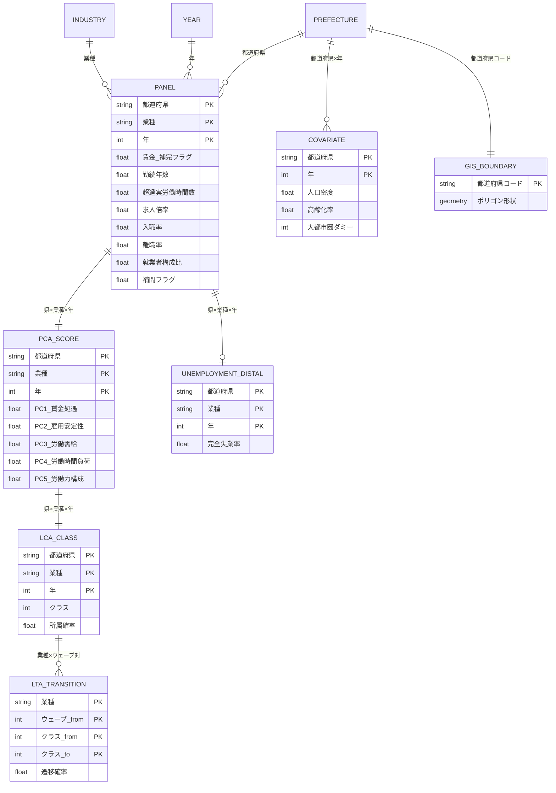

# 方針書：業種別LCAの再設計（都道府県×年・構成概念PCA・K=5・LTA）

> 提言レポート（[分析結果まとめ_提言レポート簡易版.md](過去分/分析結果まとめ_提言レポート簡易版.md)）のレビューを受けて、業種LCA分析を大幅に再設計するための方針書。
> **本方針書は [要件定義書.md](要件定義書.md) の §3.2〜3.4（分析単位・潜在変数設計・時間軸）を改訂する。** 要件定義書本体への反映は本方針の実行完了後に別途行う。
> 策定日：2026-07-21

---

## 第1章 位置づけ・背景

### 1.1 なぜ再設計するか
現行の業種LCA（[Step3_業種LCA分析結果.md](過去分/Step3_業種LCA分析結果.md)）は以下の弱点を持つ。本方針は設計そのものを組み替えて解消する。

| # | 現行の弱点 | 本方針での解消 |
|---|---|---|
| 1 | 相対エントロピー0.080＝クラス分離が弱い | 指標を4→25（5構成概念×5変数）に拡張し、構成概念ごとにPCA→5主成分に集約（第4章） |
| 2 | レコード81と少ない | 単位を都道府県×年に変更し約940/業種へ（第3章） |
| 3 | 真の完全失業率が未算出（分母空欄） | 労働力人口を分母に取得し算出（第6章） |
| 4 | 年次断面の不整合 | 年次ウェーブ＋国勢調査系を補間（第7章） |
| 5 | 除外産業（電気ガス・公務・分類不能） | 「その他」クラスとして保持（第8章） |
| 6 | 因果を主張できない | 時系列順序＋交絡調整＋LTAで「調整済みの説明」へ（第2・9章） |

### 1.2 要件定義書との関係
- **改訂する**：§3.3（分析単位＝全国×業種 → **都道府県×年、業種別3本**）、§3.4（時間軸＝プール → **年次ウェーブ＋LTA**）、§3.2（1段階/2段階 → **5構成概念×5変数を構成概念ごとにPCA→5主成分**に具体化）。
- **継承する**：完全失業率をLCA指標に含めない（distal outcome）、業種特定重視、OLS等の補助手法可、幅広い観測変数収集。

---

## 第2章 因果とLCA — 参照論文の評価と本分析の因果戦略

### 2.1 LCAは因果モデルではない
LCA（潜在クラス分析）は、複数の観測指標の背後にある**見えない下位集団（潜在クラス）を取り出す測定・類型化モデル**である。「どんな型が存在し、どの単位がどの型か」に答える記述的手法であって、「XがYを引き起こすか」には単独では答えない。したがって「LCAだから因果が言える」わけではない。

### 2.2 参照論文（新井ほか2024）の評価
`C:\Users\sk062\Downloads\2-2-811.pdf`「潜在クラス分析を用いた社会生活基本調査ミクロデータにおける介護負担と睡眠時間に関する検討」（統計研究彙報 第81号, 2024）を精読した。

**結論：この論文は因果を実証していない。記述的類型化＋交絡調整済みの"関連"の研究である。**

| 観点 | 論文の実態 |
|---|---|
| データ | 社会生活基本調査2006年の**単一横断面**（匿名データ、介護者14,132レコード） |
| 手法 | 5活動指標を3水準カテゴリ化 → **9クラス**（AIC＋解釈可能性で選択） → クラス所属を7予測因子に**多項ロジスティック回帰** → **AOR（調整済みオッズ比）** を報告 |
| アウトカム | 自殺は**実測されていない**。「自殺に繋がりかねないハイリスク群の同定」という蓋然性リンクにとどまる |
| 表現 | 一貫して「関連性・可能性・示唆・同定」。因果語（〜が〜を引き起こす）は用いない |
| 概念図 | 図1（Anderson 2019準拠）で予測因子→生活行動パターン→自殺関連行動を描くが、これは**仮説**であり効果同定はしていない |

**なぜ因果でないか（4点）**：①横断で時系列順序がない、②アウトカム未実測、③報告値AORは交絡調整済みの**関連**（オッズ比）であって因果効果ではない、④概念図は仮説にとどまる。

**逆に、因果的関連性に近づける良い設計を持つ（本方針が範とする点）**：
- **交絡/予測因子を"指標"ではなく"共変量"として多項ロジで扱う**（3-step / covariate方式）。← 本方針の観測変数設計（第4章）の直接の裏付け。
- 明示的な概念モデル（仮説）を先に置く。
- 「関連性・可能性」で誠実にヘッジする。

### 2.3 本分析の因果戦略（4条件で近づける）
参照論文が持たない「時系列順序」「動学」を足し、LCAを因果に近づける。

1. **時系列順序**：先の期(t)の労働特性 → 後の期(t+1)の完全失業率、という向きで分析する。
2. **交絡の調整**：交絡因子は**共変量**として扱い（＝LCAの指標に混ぜない）、クラス所属や distal outcome の回帰で調整する（第4章の共変量セット）。
3. **曝露（原因）の明確化**：不安定型クラスへの所属を「曝露」と定義する。
4. **LTA（潜在推移分析）**：国勢調査ウェーブ間でクラス遷移をモデル化し、動学（時点間の変化）を導入する（第9章）。

**到達点の線引き（主張水準）**：観察データである以上、到達できるのは
> 「時系列順序づけと交絡調整のうえでの**調整済みの説明**」＋「LTAによる**クラス遷移の動学的記述**」
であり、**実験的因果（処置効果の同定）は主張しない**。この表現テンプレを論文・レポートで固定する（第11章⑥）。

---

## 第3章 分析単位の再設計（都道府県×年、業種別3本）

- **単位＝都道府県×年**。ターゲット3業種（**製造業／卸売業，小売業／サービス業他**、[Step2_失業者数時系列分析.md](過去分/Step2_失業者数時系列分析.md)で選定）ごとに**個別にLCAを3本**回す。
- **レコード数**：47都道府県 × 年次ウェーブ。年次（例：2005〜2024）なら約 **47×20 ≈ 940レコード/業種**。現行81から大幅増となり、K=5・PCAの安定性を確保する（弱点2の解消）。
- 各業種のLCAは「その業種の中で、都道府県×年がどの労働市場タイプに属するか」を分類する。5クラスをレーダーで表現し、都道府県を地図上でクラス色分けする。

---

## 第4章 観測変数の再設計（5構成概念 × 5変数 → 構成概念ごとにPCAで1主成分 → 5主成分をLCAへ）

### 4.1 設計方針：構成概念ごとの主成分化（block PCA）
潜在変数は全指標のグローバルPCAで作らず、**構成概念（潜在変数）ごとに主成分化**する。
- **1つの構成概念 ＝ 5つの観測変数**を投入し、**その5変数だけをPCAして第1主成分（＝その構成概念のスコア）に丸める**。
- 構成概念は**5つ**とし、結果として **5つの主成分スコア**を得る。これをLCAの投入指標（＝レーダーの5軸）とする。
- 合計 5構成概念 × 5変数 ＝ **25観測変数**を収集する（従来案「16指標→全体PCA→5主成分」からの精緻化）。

**利点**：各LCA軸（＝レーダー軸）が「賃金・処遇」「雇用の安定性」等の**名前のついた構成概念に一意対応**し、解釈とレーダーの可読性が高い。

### 4.2 構成概念と投入する5変数（都道府県×産業×年）
取得可否は第10章で管理。ある構成概念で5変数が揃わない場合は**3変数以上**でその構成概念のPCAを行う。**完全失業率は distal outcome のため、いずれの構成概念にも入れない**（トートロジー回避、第6章）。「向き」列＝PCA前に「高いほどその構成概念が強い」向きへ揃える際の符号の目安。

**構成概念1：賃金・処遇**（主に賃金構造基本統計＝全国×産業→比率補完）

| 変数 | 向き | 取得 |
|---|---|---|
| 所定内給与額 | ＋ | 比率補完 |
| 年間賞与その他特別給与額 | ＋ | 比率補完 |
| 時間当たり所定内給与（給与÷所定内労働時間） | ＋ | 比率補完（導出） |
| 男女間賃金比（女性÷男性給与） | ＋ | 比率補完 |
| 年齢間賃金格差（例：50代÷20代給与） | ＋ | 比率補完（要確認） |

**構成概念2：雇用の安定性**

| 変数 | 向き | 取得 |
|---|---|---|
| 平均勤続年数 | ＋ | 賃金構造・比率補完 |
| 離職率 | − | 雇用動向・県×産業 |
| 入職率 | − | 雇用動向・県×産業 |
| 倒産・休廃業件数（規模調整） | − | 全国×産業・比率補完 or 県×産業（要確認） |
| 非正規雇用比率 | − | 就業構造基本調査（要確認） |

**構成概念3：労働需給（求人側）**（失業率は使わない）

| 変数 | 向き | 取得 |
|---|---|---|
| 産業別有効求人数（規模調整） | ＋ | 職業安定2-6・県×産業 |
| 就職者数（規模調整） | ＋ | 職業安定2-6・県×産業 |
| 就職率（就職者数÷求人数） | ＋ | 導出 |
| 新規求人数の増減率 | ＋ | 職業安定・県×産業（要確認） |
| 求人充足率 | ＋ | 導出（要確認） |

**構成概念4：労働時間・負荷**（主に賃金構造/毎月勤労＝全国×産業→比率補完）

| 変数 | 向き | 取得 |
|---|---|---|
| 超過実労働時間数 | ＋ | 比率補完 |
| 所定内労働時間数 | ＋ | 比率補完 |
| 総実労働時間 | ＋ | 比率補完（導出） |
| 出勤日数 | ＋ | 毎月勤労・比率補完（要確認） |
| 有給休暇取得率（低いほど負荷大） | − | 就労条件総合調査（要確認） |

**構成概念5：労働力構成・人的資本**（主に国勢調査＝県×産業）

| 変数 | 向き | 取得 |
|---|---|---|
| 女性就業者比率 | ＋ | 国勢調査・県×産業 |
| 高齢就業者比率（65歳以上） | ＋ | 国勢調査・県×産業 |
| 若年就業者比率（15〜34歳） | ＋ | 国勢調査・県×産業 |
| 大卒以上比率（人的資本） | ＋ | 国勢調査/学歴（要確認） |
| 平均年齢（or 年齢中央値） | ＋ | 国勢調査・県×産業（要確認） |

### 4.3 手順
1. 各変数を「高いほどその構成概念が強い」向きに揃え（4.2の向き列）、欠損処理（第11章③）。
2. **z標準化**。
3. **構成概念ごとに5変数をPCA → 第1主成分をその構成概念スコアに採用**。各構成概念の第1主成分の寄与率・負荷量を保存。**第1主成分の寄与率が低い（＝一次元でない）構成概念は変数構成を見直す**。
4. 5つの構成概念スコア（5主成分）をLCAへ投入。負荷量・寄与率・累積・得点を `data/processed/pca_<industry>_<construct>.csv` に保存（要件定義書§5準拠）。

### 4.4 方法論上の注意（明記する）
- 各構成概念スコアは連続値のため、LCAは実装上**LPA（連続主成分のGaussian混合）**または**主成分を3分位化してpoLCA**の2案を試行し、解釈性で選ぶ（呼称は「LCA」で統一、要件定義書§3.2）。
- 構成概念内の5変数は**正相関・一次元**を仮定。満たさない構成概念は変数を差し替える（4.3-3）。
- **tandem（PCA→クラスタリング）**の注意点を踏まえ、**1段階（構成概念スコアでなく変数を直接投入）版も参考比較**する。

### 4.5 交絡は指標に混ぜない（共変量セット）
参照論文の設計（第2章）に倣い、交絡因子はLCA指標ではなく**共変量**として別に保持し、クラス所属・distal outcome の調整に使う。
- 共変量候補：人口密度、高齢化率、大都市圏ダミー、県内景気/求人環境（有効求人倍率・全産業）、県レベル賃金水準 など。

---

## 第5章 クラス数 K=5（レーダー目的で固定）

- レーダーチャート作成の意図から **K=5 を固定**する。
- ただし統計的根拠として **K=2〜7 で AIC・BIC・相対エントロピー・（可能なら BLRT）を必ず算出・報告**する（参照論文もAICで選択）。
- **K=5の採否ルール**（第11章④）：全クラスが非空・収束し、相対エントロピー ≥ 目安0.5 を満たせば採用。退化する場合は K=5（可視化用）と統計的最適 K\*（併記）の**両方を提示**する。
- 実装：共分散＝対角、ランダムスタート ≥50 で局所解を回避。

---

## 第6章 アウトカム＝完全失業率（都道府県×業種）

- **定義**：完全失業率 = 失業者 ÷ 労働力人口（＝就業者 ＋ 失業者）。**分母（業種別労働力人口）を新規取得**して算出する。
- **前職産業の注意**：失業者は「前職の産業」で分類されるため、業種別失業率は概念的に注意が要る（現に就業していない者を業種に帰属させる）。この定義を明記する。
- **フォールバック**（決着⑤）：都道府県×業種の失業者が非公表なら、**県レベル完全失業率（全産業）** を distal outcome として県キーで結合する。
- **LCA指標には含めない**（distal outcome、トートロジー回避）。既存 [`unemployment_rate_by_industry.csv`](../data/processed/unemployment_rate_by_industry.csv) の空欄分母を埋める作業を含む。

---

## 第7章 年次断面の扱い

- **年次ウェーブ**（例：2005〜2024）を時間軸とする。
- 国勢調査系（就業構成・労働力状態、5年間隔）は**比率/線形で年次補間**し、補間箇所を**フラグ列**で明示する（決着②）。
- 感度分析として「国勢調査年のみ（補間なし）」版も比較する（第12章 Step6）。

---

## 第8章 除外産業の扱い

- これまで曝露度計算から落としていた **電気・ガス・水道／公務／分類不能** を、**「その他」クラス（バケット）として保持**する。分母・曝露度・地図から除外しない。従来の「除外」方針を廃止する。

---

## 第9章 時系列・LTA設計

- **国勢調査ウェーブ（→年次補間後は年次ウェーブ）間のクラス遷移**を LTA でモデル化する（業種別）。
- 出力：**遷移確率行列**（あるクラスが翌ウェーブでどのクラスへ動くか）、クラスの時間的安定性。
- **推定安定化の制約**（決着②）：**測定不変**（クラス定義パラメータをウェーブ間で等値制約）＋**一次・定常遷移**（遷移行列をウェーブ対で共有）。
- 実装候補：Python `stepmix`（LCA/LPA/LTA対応）、または R `poLCA`＋手組み。

---

## 第10章 データ収集タスク（都道府県×産業×年）

| # | 指標群 | 出典（統計名） | 粒度 | 取得可否 | 出力先（想定） |
|---|---|---|---|---|---|
| 0-1 | 就業者構成・労働力状態 | 国勢調査 | 県×産業大分類・5年 | 就業=取得済／労働力状態=**要取得** | `data/raw/census_*.csv` |
| 0-2 | 求人数・就職者数 | 職業安定業務統計 2-6 | 県×産業・年次 | 取得可 | `data/raw/job_offer_industry_pref.csv` |
| 0-3 | 入職率・離職率 | 雇用動向調査 | 県×産業大分類・年次 | 取得可 | `data/raw/employment_trends_prefecture.csv` |
| 0-4 | 賃金・勤続・超過労働・賞与・倒産・学歴 | 賃金構造基本統計/倒産統計 | **全国×産業×年**（→比率補完） | 取得可 | `data/raw/02_reuse/*`＋追加年 |
| 0-5 | 完全失業率・有効求人倍率・賃金(全産業)・人口密度・高齢化率 | 社会人口統計体系ほか | 県×全産業×年 | 取得可 | `data/raw/sdds_prefecture.csv` |
| 0-6 | 県境界ポリゴン | 国土数値情報/jSTAT MAP | 47県 | 要取得 | `data/raw/gis/prefectures.geojson` |
| 0-7 | データ辞書・ER図 | — | 県×産業×年粒度へ更新 | `docs/データ辞書.md`, `docs/ER図.md` |

「要確認」の指標は Step0 で取得を試み、取れなければ候補から外す。

---

## 第11章 事前決着事項（残る限界の解消）

実行後の手戻りを防ぐため、想定される限界をあらかじめ決定ルール化する。

### ① 賃金・勤続・超過労働の県×産業非公表 → 比率補完＋必須の頑健性
- 補完式：`県×産業×年 値 = 全国×産業×年 値 × (県×全産業×年 値 ÷ 全国×全産業×年 値)`。補完値は**フラグ列**で明示。
- **必須頑健性**：補完25変数版と「県別に実在する変数のみ」版を**並走**し、クラス構造・遷移が補完に**過度依存しないか**を確認。依存が強ければ**実データ版を主**とする。

### ② 年次解像度／ウェーブの薄さ → 年次ウェーブ＋補間＋制約付きLTA
- 年次ウェーブ。国勢調査系は比率/線形で年次補間（フラグ）。LTAは測定不変＋一次・定常遷移で推定安定化。

### ③ 県×産業指標の欠損 → 閾値ルール
- 補完後も**欠損>20%の指標は除外**。補完法（業種内中央値/線形）を事前登録。生存指標でPCA。

### ④ K=5の統計非最適 → 併記と採否ルール
- K=2〜7で AIC/BIC/相対エントロピー/（可能なら BLRT）を必ず算出・報告。採用条件＝全クラス非空・収束・相対エントロピー≥目安0.5。退化時は K=5（可視化）と K\*（統計）を両提示。実装＝共分散対角・ランダムスタート≥50。

### ⑤ 前職産業ベースの失業率 → 定義固定＋フォールバック
- 「前職産業」区分で定義、分母＝労働力人口。distal なので LCA 本体は非バイアス。県×産業の失業者が非公表なら県レベル完全失業率を県キー結合するフォールバックを事前規定。

### ⑥ 観察データの因果限界 → 主張水準の事前固定
- 主張は「調整済みの説明・動学的記述」まで。実験的因果は主張しない。交絡は共変量として扱う。第2.3節の表現テンプレを全成果物で固定。

---

## 第12章 実行手順（Step 0〜7）

| Step | 内容 | 主な入力 → 出力 |
|---|---|---|
| **0 データ収集** | 第10章の0-1〜0-7を取得。データ辞書・ER図を県×産業×年粒度へ更新 | e-Stat等 → `data/raw/*` |
| **1 前処理・テーブル構築** | 年次補間＋比率補完（フラグ）→25変数（5構成概念×5）を県×産業×年で統合→欠損>20%除外→z標準化。完全失業率(分母埋め)をdistalとして別保持。交絡共変量セット構築 | `data/raw/*` → `data/processed/panel_<industry>.csv` |
| **2 構成概念PCA** | 業種別に**構成概念ごと（5変数）にPCA→第1主成分**を採用し5主成分を保存（負荷量・寄与率・累積・得点）。1段階（変数直接投入）版も参考保持 | panel → `pca_<industry>_<construct>.csv` |
| **3 業種別LCA（3本・K=5）** | 各業種で5主成分→LCA、K=2〜7で指標算出、K=5採否ルール、クラスプロファイル、業種別×5クラスのレーダー、県クラス地図 | pca → `lca_<industry>.csv`, 図 |
| **4 LTA** | 年次ウェーブで遷移推定（測定不変＋定常）、遷移確率行列、時間安定性の可視化 | panel → `lta_<industry>.csv`, 図 |
| **5 アウトカム＆因果** | distal（完全失業率）をクラス別比較＋交絡共変量で調整、時系列順序(t指標→t+1失業率)、主張水準テンプレで記述 | lca＋distal → 調整済み関連の表 |
| **6 頑健性** | 補完あり/なし・県別実データのみ版、大都市圏除外、K=5 vs K\*、年次補間の感度 | 上記各出力 → 感度分析表 |
| **7 まとめ更新** | 提言レポート・ER図・要件定義書§3.3-3.4改訂へ反映 | 全成果物 → docs更新 |

各Stepは PDCA として往復してよい（要件定義書§8の方針を継承）。

---

## 第13章 成果物・改訂ER図・検証

### 13.1 改訂ER図（都道府県×産業×年）

### 13.2 成果物（改訂版ER図 ＋ 分析結果まとめレポート）
本再設計の**主成果物は次の2つ**とする。

**(A) 改訂版ER図**（13.1、都道府県×産業×年粒度）。実行フェーズ Step0 でデータ辞書とともに更新する。

**(B) 分析結果まとめレポート**（`docs/分析結果まとめ_業種別LCA再設計版.md`、実行フェーズ Step7 で作成）。既存の[提言レポート簡易版](過去分/分析結果まとめ_提言レポート簡易版.md)の後継として、再設計の分析結果を一望できるようにまとめる。構成：

1. **背景・目的**（再設計の狙い）
2. **使用データとデータリネージ**（改訂版ER図・[データ辞書](過去分/データ辞書.md)へのリンク）
3. **手法**（構成概念PCA → 業種別LCA×3〈K=5〉 → LTA、因果戦略）
4. **結果**：
   - 業種別 × **5クラスのレーダーチャート**（5構成概念軸）× 3業種
   - 都道府県の**クラス地図** × 3業種
   - **LTA遷移図**（クラス遷移確率）
   - 各構成概念の**PCA寄与率・負荷量**
   - **完全失業率（distal）の交絡調整済み比較**
5. **考察・業種特定に基づく提言**
6. **限界と対応**（第11章の事前決着を反映）
7. **付録**（K=2〜7の統計量・感度分析）

**支援的な中間出力**：panel/pca/lca/lta の各CSV、K選択統計量、感度分析表。

### 13.3 検証
- ユーザーの全要望に1対1対応（因果評価・時系列/LTA・交絡=共変量・その他クラス・レコード増・5構成概念×5変数→構成概念PCA→5主成分・業種別3本・K=5・真の失業率・年次補間・成果物＝改訂版ER図＋まとめレポート）。
- 第11章の6決着が「限界→決定/決定ルール」の形で開いた限界を残さないこと。
- `class1_share + class2_share ≈ 1` 等の整合、mermaid の描画、リンクの有効性。

---

## 付記：ユーザー10要望への対応マップ

| 要望 | 対応章 |
|---|---|
| LCAで因果は言えるか／参照論文は因果か | 第2章 |
| 時系列的意識を組み込む | 第2.3・7・9章 |
| 交絡因子も観測変数に | 第2.2・4.4章（＝共変量として） |
| 除外産業を「その他」クラスに | 第8章 |
| レコード81が少ない→増やす | 第3章（→約940/業種） |
| 主成分として投入・1構成概念=5変数で丸める | 第4章（5構成概念×5変数→構成概念ごとPCA→5主成分） |
| 投入する変数を明記 | 第4.2章（構成概念別の25変数一覧） |
| ターゲット業種で個別に3本LCA | 第3・第12章Step3 |
| クラス数5（レーダー目的） | 第5章 |
| 真の完全失業率（分母取得） | 第6章 |
| 年次を揃える（補間 or 揃う年のみ） | 第7章（補間主・感度で揃う年） |
| 成果物＝改訂版ER図＋分析結果まとめレポート | 第13章 |
