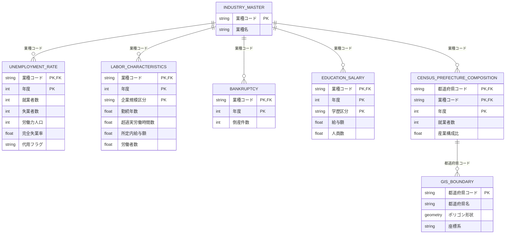

# ER図（Entity-Relationship Diagram）

## 概要
業種別失業率分析と地理的統合のためのテーブル関係図。業種側（全国粒度）と地理側（都道府県粒度）の2つのレイヤーで構成され、「業種→クラス対応表」と「産業構成比」を介して統合される。

---

## 正式ER図（Mermaid erDiagram）



---

## テーブル加工ロジック（元ファイル→加工内容→出力）

### 1. 完全失業率テーブル（UNEMPLOYMENT_RATE）

**元ファイル**：
- 失業者数：`data/raw/02_reuse/失業者 - シート1_共通年_統一.csv`（分子）
- 労働力人口：`data/raw/census_industry_prefecture.csv`（分母用就業者数）

**加工内容**：
1. 失業者数の実データ年（2014, 2018〜2025）を基準行に採用する（国勢調査の年ではない）
2. 各年の労働力人口は、対応する国勢調査年（5年おき）の全国就業者数を代用する
   - 2014年 → 2015年国勢調査使用、代用フラグ=1
   - 2018〜2019年 → 2015年国勢調査使用、代用フラグ=1
   - 2020年 → 2020年国勢調査使用、代用フラグ=0（完全一致）
   - 2021〜2025年 → 2020年国勢調査使用、代用フラグ=1
3. 完全失業率 = 失業者数 ÷ (就業者数+失業者数) × 100 で算出
4. **重要**：このテーブルはLCAの観測変数に含めない（distal outcomeとして事後比較のみ）

**出力**：`data/processed/unemployment_rate_by_industry.csv`

---

### 2. 労働特性テーブル（LABOR_CHARACTERISTICS）

**元ファイル**：
- `data/raw/02_reuse/勤続年数・超過実労働時間数・所定内給与額_時系列_共通年_統一.csv`

**加工内容**：
1. `区　分` 列で「男　女　計」かつ「学歴計」かつ「全年齢」の行のみ抽出
2. 企業規模区分（4段階：10人未満、10～99人、100～999人、1,000人以上）別に行を保持
3. 業種（9分類）×年度×企業規模区分の粒度に整理（重複排除）
4. 欠損値は明示的にNaNとして保持

**出力**：`data/processed/labor_characteristics_by_industry.csv`

---

### 3. 倒産件数テーブル（BANKRUPTCY）

**元ファイル**：
- `data/raw/02_reuse/産業別年間倒産件数表_共通年_統一.csv`

**加工内容**：
1. 業種（9分類）×年度の粒度で変換なし（既に正しい粒度）
2. 欠損確認：全業種全年度に対して値の完全性を検証（Step 1で欠損なし確認済み）

**出力**：`data/processed/bankruptcy_by_industry.csv`（そのまま参照またはコピー）

---

### 4. 学歴別給与テーブル（EDUCATION_SALARY）

**元ファイル**：
- `data/raw/02_reuse/education/学歴、年齢階級別きまって支給する現金給与額_<年度>.xlsx`（20ファイル、2006〜2025年）

**加工内容**：
1. 各Excelファイル（.xlsx, .xls混在）をCSVに変換
2. 業種（9分類）×年度×学歴区分（5分類）×年齢階級の粒度で行を抽出
3. さらに、業種×年度ごとに「学歴計・全年齢」の給与額・人員数を集約
4. 出力形式：
   - 学歴別の細粒度版：`data/processed/education_by_industry_raw.csv`
   - 集約版（LCA投入用）：`data/processed/education_by_industry.csv`

**出力**：
- `data/processed/education_by_industry.csv`（業種×年度粒度）

---

### 5. 国勢調査都道府県別産業構成テーブル（CENSUS_PREFECTURE_COMPOSITION）

**元ファイル**：
- `data/raw/census_industry_prefecture.csv`

**加工内容**：
1. 産業大分類コード（19分類）を業種（9分類）にグループ化（データ辞書の業種マッピング表に従う）
2. 47都道府県×グループ化済み業種×性別（男女計のみ）×年度（2005, 2010, 2015, 2020）の粒度に整理
3. 産業構成比（%）を算出：各都道府県・年度内での業種別就業者数の割合

**出力**：`data/processed/census_prefecture_composition.csv`

---

### 6. GIS境界データテーブル（GIS_BOUNDARY）

**状態**：未取得（Step 3前にユーザーと一緒に取得予定）

**計画される加工内容**（取得後）：
1. 都道府県ポリゴン（Shapefile または GeoJSON）を標準化
2. 座標系を統一（JGD2000 または WGS84）
3. 都道府県コード（JIS標準）・都道府県名をキー属性として保持

**出力**：`data/raw/gis/prefectures.geojson` または `prefectures.shp`

---

## テーブル構成図

```
┌─────────────────────────────────────────────────────────────────────────┐
│                    【業種側テーブル群】（全国粒度）                        │
│                                                                          │
│  ┌──────────────────┐        ┌──────────────────┐                      │
│  │ 完全失業率       │        │ 労働特性データ    │                      │
│  │ (業種別)         │        │ (企業規模別)     │                      │
│  ├──────────────────┤        ├──────────────────┤                      │
│  │ 業種             │        │ 業種             │                      │
│  │ 年度             │◄──────►│ 年度             │                      │
│  │ 完全失業率       │        │ 勤続年数         │                      │
│  │ 就業者数         │        │ 超過実労働時間   │                      │
│  │ 失業者数         │        │ 所定内給与額     │                      │
│  │ 労働力人口       │        │ 労働者数         │                      │
│  └──────────────────┘        └──────────────────┘                      │
│                                                                          │
│  ┌──────────────────┐        ┌──────────────────┐                      │
│  │ 倒産件数         │        │ 学歴別給与       │                      │
│  │ (業種別)         │        │ (業種×学歴別)    │                      │
│  ├──────────────────┤        ├──────────────────┤                      │
│  │ 業種             │◄──────►│ 業種             │                      │
│  │ 年度             │        │ 年度             │                      │
│  │ 倒産件数         │        │ 学歴別給与額     │                      │
│  │ （件/年）        │        │ （学歴別人員数） │                      │
│  └──────────────────┘        └──────────────────┘                      │
│                                                                          │
│                              ↓                                          │
│                     【LCA 潜在変数作成】                                │
│                   (要件定義書 3.2, Step 1)                              │
│                                                                          │
│            業種ごとのプロファイル（指標スコア）                          │
│               ↓                                                         │
│    【LCA 実行・業種クラス決定】                                         │
│    (Step 2: 2～6クラスを探索)                                          │
│               ↓                                                         │
│   【業種→クラス対応表】 (9業種 → N クラス)                             │
│                                                                          │
└─────────────────────────────────────────────────────────────────────────┘
                                  │
                    【結合キー】業種コード対応
                                  │
                                  ↓
┌─────────────────────────────────────────────────────────────────────────┐
│                    【地理側テーブル群】（都道府県粒度）                    │
│                                                                          │
│  ┌──────────────────────────┐    ┌──────────────────────────┐         │
│  │ 国勢調査                  │    │ GIS 地理データ            │         │
│  │ (都道府県別産業構成比)    │    │ (都道府県ポリゴン)        │         │
│  ├──────────────────────────┤    ├──────────────────────────┤         │
│  │ 都道府県                  │    │ 都道府県                  │         │
│  │ 産業大分類コード          │◄──►│ ジオメトリ（形状）        │         │
│  │ 就業者数（産業別）        │    │ CRS（座標系）            │         │
│  │ 産業構成比                │    │ 都道府県コード            │         │
│  │ 年度 (5年ごと)            │    │ 都道府県名                │         │
│  │                           │    │                          │         │
│  │ → 業種側との合算:          │    │ 備考：未取得              │         │
│  │   「産業大分類」を9業種に  │    │ Step 3で取得予定          │         │
│  │   グループ化（データ辞書   │    │ (ユーザーと一緒に)       │         │
│  │   参照）                  │    │                          │         │
│  └──────────────────────────┘    └──────────────────────────┘         │
│                                                                          │
│                   【曝露度指標算出】 (Step 3)                           │
│          都道府県別の産業構成比 × 「業種→クラス」対応表                │
│                       ↓                                                │
│         都道府県ごとの「高リスククラス曝露度」指標                      │
│                                                                          │
│   ┌────────────────────────────────────────────────────────┐           │
│   │ 空間統計（Moran's I 等）                              │           │
│   │ 近隣都道府県との類似性・空間的自己相関               │           │
│   │ (要件定義書 3.3, Step 3)                               │           │
│   └────────────────────────────────────────────────────────┘           │
│                                                                          │
│   ┌────────────────────────────────────────────────────────┐           │
│   │ 地理マッピング（可視化）                              │           │
│   │ ・曝露度マップ                                        │           │
│   │ ・完全失業率マップ（都道府県別全産業計）              │           │
│   │ ・47都道府県レーダーチャート（7×7グリッド）          │           │
│   └────────────────────────────────────────────────────────┘           │
│                                                                          │
└─────────────────────────────────────────────────────────────────────────┘
```

---

## テーブル詳細と結合仕様

### 【業種側レイヤー】全国粒度

#### (1) 完全失業率テーブル
```
テーブル名: unemployment_rate_by_industry
ファイル: data/processed/unemployment_rate_by_industry.csv

構造:
  業種（9分類）─────┐
                    ├─→【結合キー】
  年度 ─────────────┤
  
  就業者数（人）
  失業者数（人）
  労働力人口（人）
  完全失業率（%）
  
結合相手:
  ・労働特性テーブル（業種、年度で結合）
  ・倒産件数テーブル（業種、年度で結合）
  ・学歴別給与テーブル（業種、年度で結合）

【重要】Step 2（LCA実行時）:
  この完全失業率カラムは【指標に含めない】
  クラス決定後、distal outcome として事後比較のみ使用
  （要件定義書 3.2節「トートロジー回避」）
```

#### (2) 労働特性テーブル
```
テーブル名: 勤続年数・超過実労働時間数・所定内給与額_時系列_共通年_統一
ファイル: data/raw/02_reuse/勤続年数・超過実労働時間数・所定内給与額_時系列_共通年_統一.csv

構造:
  業種（9分類）──────────────┐
  年度 ──────────────────────┼─→【結合キー】
  企業規模（4区分：10人未満、│
             10-99、100-999、│
             1000+）──────────┤
  年齢階級（複数種類）────────┤
  学歴（複数種類）────────────┘
  
  勤続年数（年）
  超過実労働時間（時間/月）
  所定内給与額（千円/月）
  労働者数（千人）
  
Step 1 で必要な処理:
  【複数の属性軸があるため、LCA投入前に集約】
  ・男女計・学歴計・全年齢層の「総平均」を業種×年度ごとに算出
  ・企業規模別の平均値も検討（全規模の加重平均か、大企業（1000+）のみか）
  → 集計方法は Step 1の「記述統計・欠損確認」で確定

結合相手:
  ・完全失業率テーブル（業種、年度で内部結合）
  ・倒産件数テーブル（業種、年度で左外結合）
  ・学歴別給与テーブル（業種、年度で内部結合）
```

#### (3) 倒産件数テーブル
```
テーブル名: 産業別年間倒産件数表_共通年_統一
ファイル: data/raw/02_reuse/産業別年間倒産件数表_共通年_統一.csv

構造:
  業種（9分類）─────┐
                    ├─→【結合キー】
  年度 ─────────────┘
  
  倒産件数（件/年）
  
結合相手:
  ・労働特性テーブル（業種、年度で結合）
  
【注記】企業存続性の指標。LCA観測変数候補の1つ
       年度による欠損の可能性を Step 1で確認
```

#### (4) 学歴別給与テーブル
```
テーブル名: 学歴別給与データ（複数ファイル）
ファイル: data/raw/02_reuse/education/学歴、年齢階級別きまって支給する現金給与額_<年度>.xlsx
          （20ファイル、平成18年～令和7年、2006～2025年）

構造:
  業種（9分類）──────────────┐
  年度 ──────────────────────┼─→【結合キー】
  学歴（5分類）─────────────┤
  年齢階級（複数）──────────┘
  
  給与額（千円/月）
  人員数（千人）
  
Step 1 で必要な処理:
  【複数の属性軸があるため、LCA投入前に集約】
  ・業種×年度ごとに「学歴計・全年齢層」の総給与額を算出
  ・または、学歴別のPCAで「人的資本」潜在変数を先に作成（3.2節で検討）

結合相手:
  ・労働特性テーブル（業種、年度で内部結合）
  
【注記】人的資本の指標。時系列最長（20年分）のテーブル
```

---

### 【地理側レイヤー】都道府県粒度

#### (5) 国勢調査テーブル（都道府県別産業構成比）
```
テーブル名: 国勢調査（産業大分類×都道府県別）
ファイル: data/raw/census_industry_prefecture.csv

構造:
  都道府県コード（JIS）─────┐
  産業大分類コード ─────────┼─→【結合キー】
  性別（男女計など）────────┤
  年度（5年ごと）───────────┘
  
  就業者数（人）
  人口構成比（%）
  
【業種側への統合方法】
  産業大分類（19分類）を業種側の9分類にグループ化
  （データ辞書の「業種マッピング表」参照）
  
  例：
    A農業，林業（コード120）
    B漁業（コード130）      ─→ グループ化 → 「農・林・漁・鉱業」
    C鉱業（コード150）
  
結合相手:
  ・GIS地理データ（都道府県コード、年度で結合）
  
Step 3 での処理:
  1. 都道府県別の「業種別産業構成比」を算出
  2. 業種→クラス対応表（Step 2で得た結果）と掛け合わせ
  3. 都道府県ごとの「高リスククラスへの曝露度指標」を計算
     曝露度 = Σ(業種の産業構成比 × そのクラスのリスク度)

【年度について】
  国勢調査は5年ごと（2005, 2010, 2015, 2020年）
  複数年データ使用時に他テーブル（年度別）との統合が必要
  → データ辞書の「年度の整合性」セクション参照
```

#### (6) GIS 地理データテーブル（未取得）
```
テーブル名: 都道府県ポリゴン（GIS境界データ）
ファイル: data/raw/gis/prefectures.geojson （計画）

【重要】このテーブルはまだ未取得。
        ユーザーと一緒に Step 3 前に取得する予定。

計画される構造:
  都道府県コード（JIS）
  都道府県名
  ジオメトリ（ポリゴン形状）
  座標系（CRS）：JGD2000 or WGS84

結合相手:
  ・国勢調査テーブル（都道府県コード、年度で結合）
  
Step 3 での処理:
  1. 地理マッピング（曝露度指標・完全失業率を色分け表示）
  2. 空間統計（Moran's I 等で近隣県との相関検定）
  3. 都道府県別レーダーチャート（7×7グリッド表示）
```

---

## 業種コード対応表（詳細版）

国勢調査の「産業大分類コード」と、本テーマで使用する「業種（9分類）」のマッピング：

| 業種（9分類）<br>「共通産業列」 | 国勢調査コード | 国勢調査業種名 | 説明 |
|---|---|---|---|
| **農・林・漁・鉱業** | 120 | A 農業，林業 | 第1次産業の中核 |
| | 130 | B 漁業 | 水産業 |
| | 150 | C 鉱業，採石業，砂利採取業 | 鉱業（注：エネルギー鉱業は含まない場合も多い） |
| **建設業** | 160 | D 建設業 | 建設・土木業 |
| **製造業** | 170 | E 製造業 | 機械・電子・食品等の製造 |
| **情報通信業** | 200 | G 情報通信業 | IT・通信・放送業 |
| **運輸業** | 210 | H 運輸業，郵便業 | 物流・旅客運送・郵便 |
| **卸売業，小売業** | 220 | I 卸売業，小売業 | 商業・小売業（二次産業支援） |
| **金融・保険業** | 230 | J 金融業，保険業 | 金融機関・保険会社 |
| **不動産業** | 240 | K 不動産業，物品賃貸業 | 不動産業、レンタル業 |
| **サービス業他** | 190 | F 電気・ガス・熱供給・水道業 | インフラ（サービス分類） |
| | 250 | L 学術研究，専門・技術サービス業 | 研究開発・専門職サービス |
| | 260 | M 宿泊業，飲食サービス業 | ホテル・飲食店・観光業 |
| | 270 | N 生活関連サービス業，娯楽業 | 理容・美容・スポーツ・娯楽 |
| | 280 | O 教育，学習支援業 | 教育機関・学習塾 |
| | 290 | P 医療，福祉 | 医療・介護・福祉業 |
| | 300 | Q 複合サービス事業 | 金融以外の複合サービス |
| | 310 | R その他に分類されない産業 | 分類外産業 |

---

## 分析フロー（Step ごと）

```
【Step 0：データ収集】 ← 現在はここ（完了予定）
├─ 業種側データ：完全失業率、労働特性、倒産件数、学歴別給与
├─ 地理側データ：国勢調査（産業構成比）
└─ GIS地理データ：未取得（Step 3前にユーザーと取得）

      ↓

【Step 1：予備分析・潜在変数設計】
├─ データ統合確認：ER図に基づき結合を試行
├─ 記述統計・欠損確認
├─ 多重共線性チェック
├─ 複数年ばらつき検証
├─ 1段階 vs PCA経由2段階の試行
└─ 最終的な指標セットを確定

      ↓

【Step 2：業種LCA本体】
├─ クラス数探索（2～6クラス）
├─ クラスプロファイル整理
├─ レーダーチャート作成
├─ 完全失業率との事後比較
└─ 【出力：業種→クラス対応表】

      ↓

【Step 3：地理レイヤー統合】
├─ 曝露度指標算出
│  （国勢調査産業構成比 × 業種→クラス対応表）
├─ 都道府県別レーダーチャート
├─ 空間統計（Moran's I）実施
└─ GIS マッピング

      ↓

【Step 4：頑健性チェック・感度分析】
├─ 大都市圏除外パターン
├─ 複数年の扱い拡張
└─ 発展的分析の要否判定

      ↓

【Step 5：成果物まとめ・提言レポート】
└─ 論文作成（別タスク）
```

---

## テーブル結合の実装例（Python）

### 業種側データの統合（内部結合）
```python
# 失業率・労働特性・倒産件数・学歴別給与を業種×年度でマージ
merged_industry = unemployment_rate \
    .merge(labor_features, on=['業種', '年度'], how='inner') \
    .merge(bankruptcy, on=['業種', '年度'], how='left') \
    .merge(education_agg, on=['業種', '年度'], how='inner')

# 結果：業種×年度のマトリックス（指標は複数列）
# これを LCA の入力データフレームに使用（Step 2）
```

### 業種側と地理側の統合（曝露度算出、Step 3）
```python
# Step 2 の結果：業種→クラス対応表
# 例：
#  業種     クラス
#  農業     Class_1_高リスク
#  建設業   Class_2_安定
#  ...

# 国勢調査から都道府県別の産業構成比を取得
#   都道府県、業種（グループ化済み）、産業構成比（%）

# 曝露度計算
exposure_df = pd.merge(
    census_composition,  # 都道府県別産業構成比
    industry_class_mapping,  # 業種→クラス対応表
    on='業種'
)
exposure_df['高リスク曝露度'] = exposure_df.groupby('都道府県').apply(
    lambda x: (x[x['クラス'] == 'Class_1_高リスク']['産業構成比']).sum()
)

# 結果：都道府県ごとの「高リスククラス曝露度」指標
# これを Step 3 の地理マッピング・空間統計に使用
```

---

## データ品質・エラーハンドリングのチェックリスト

- [ ] 業種コード：国勢調査の「産業大分類コード」が正確に9分類にマッピングされているか
- [ ] 年度の対応：複数年プール時に、異なる年度の業種が混在していないか
- [ ] 欠損値：倒産件数など一部テーブルに欠損がないか（Step 1で詳細確認）
- [ ] 都道府県コード：国勢調査と GIS 地理データで同一の都道府県コード体系（JIS）を使用しているか
- [ ] 座標系：GIS 地理データの座標系（CRS）が明示的に記録されているか
- [ ] 単位：給与額（千円 vs 万円）、労働時間（時間 vs 分）など単位の一貫性
- [ ] 時系列：複数年データ使用時に「横断面プール」と「年別パネル」の方法を明確化（Step 1）

