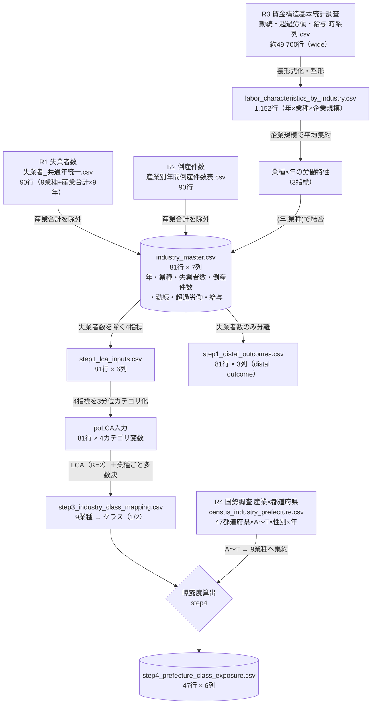

# 分析結果まとめ・提言レポート（簡易版）

> SSDSE 応募論文の素材版。**背景・目的・使用データ・分析の流れと結果・提言の方向性・現時点の問題点/限界**を一望できるようまとめたもの。論文本体ではない。
> 対象テーマ：`03_unemployment_lca_gis`（業種主軸＋地理曝露レイヤー）
> 作成時点：2026-07-21

---

## 1. 背景・目的

### 問いと着眼点
完全失業率は景気指標としてよく使われるが、「どの業種の、どんな労働特性がその変動を生むのか」までは通常の集計では見えにくい。本研究は、**完全失業率を業種の労働特性から捉え直し、それを都道府県の産業構成を通じて地理に展開する**ことを狙う。

### 02（回帰分析テーマ）との差別化
- 02 は完全失業率を目的変数とする **OLS（要因の線形説明）**。
- 本テーマ 03 は、業種を **労働特性の潜在クラスとしてパターン抽出（LCA）** し、さらに **都道府県の産業構成で地理曝露** させる。
- つまり「失業率を何が説明するか」ではなく、「**どんな労働特性の業種群が存在し、それがどの地域に厚く分布するか**」という別の切り口を提供する。

### 分析単位
**業種を主軸**とし、そこに**地理曝露レイヤー**を重ねる二層構造。

---

## 2. 使用データとデータ処理

### 2.1 収集した生データ

分析には、業種軸の3ソース（労働・倒産・賃金）と、地理軸の1ソース（国勢調査）を用いた。

| # | データ | 出典（統計） | 粒度 | 行数（生） | 主な列 |
|---|---|---|---|---|---|
| R1 | 失業者数 | 労働力調査（産業別失業者） | 年 × 業種 × 性別 | 90行 | 年・共通産業列・男女計/男/女（失業者数） |
| R2 | 倒産件数 | 産業別年間倒産件数表 | 年 × 業種 | 90行 | 年・共通産業列・倒産件数 |
| R3 | 労働特性（勤続年数・超過実労働時間数・所定内給与額） | 賃金構造基本統計調査 | 年 × 業種 × 企業規模 × 性別/学歴（wide） | 約49,700行 | 区分・産業・年度・企業規模別の各指標 |
| R4 | 産業別就業者数（地理） | 国勢調査2015/2020 | 都道府県 × 産業大分類A〜T × 性別 × 年 | 約1,500行 | 地域・性別・産業大分類・就業者数 |

- R1・R2 の生データは 9業種＋「産業合計」× 9年（**共通年 = 2014・2018〜2025**）で 90行。「産業合計」を除外して 9業種 × 9年 = **81行**にする。
- **共通年**：3ソースすべてで揃う年のみを採用したため、2015〜2017 が欠け、2014 の次が 2018 になっている。
- 業種は9区分：サービス業他／不動産業／卸売業，小売業／建設業／情報通信業／製造業／農・林・漁・鉱業／運輸業／金融・保険業。

### 2.2 生データ → 最終アウトプットの流れ（データリネージ）



**要点：**
- **賃金データ（R3）だけ前処理が重い**。wide形式（企業規模×性別×学歴）を長形式に整形（`labor_characteristics_by_industry.csv`＝1,152行）し、**企業規模で平均**して業種×年の3指標に集約する。
- 3ソースを **(年, 業種)** をキーに結合し、マスタ `industry_master.csv`（81行）を作る。
- マスタから、**失業者数は distal outcome として分離**（`step1_distal_outcomes.csv`）し、LCAには使わない。残る4指標（倒産・勤続・超過労働・給与）が LCA 入力。
- LCA は poLCA（カテゴリ前提）を使うため、4つの連続指標を各々**3分位（低・中・高）のカテゴリに離散化**してから投入する。
- LCA後、(年×業種)の割当を業種ごとに集約して「業種→クラス」対応を確定 → 国勢調査の産業構成に掛けて都道府県曝露度を算出。

### 2.3 最終アウトプットテーブルの仕様

**① 業種LCA 入力テーブル**（`step1_lca_inputs.csv` → 離散化後にpoLCAへ）

- **サンプル数：81**（9業種 × 9年）
- **列数：6**（キー2 ＋ 分析指標4）

| 列 | 役割 | 型（生） | LCA投入形 |
|---|---|---|---|
| year | キー | 整数（9種） | — |
| industry | キー | 文字列（9種） | — |
| bankruptcy_count | 倒産件数 | 連続（件） | 3分位カテゴリ |
| 勤続年数 | 勤続 | 連続（年） | 3分位カテゴリ |
| 超過実労働時間数 | 労働強度 | 連続（時間） | 3分位カテゴリ |
| 所定内給与額 | 賃金 | 連続（千円） | 3分位カテゴリ |

→ 実際に poLCA に入るのは **81サンプル × 4カテゴリ変数（各3水準）**。失業者数は `step1_distal_outcomes.csv`（81行×3列）に distal outcome として分離。

**② 都道府県曝露度テーブル**（`step4_prefecture_class_exposure.csv`）

- **サンプル数：47**（都道府県）
- **列数：6**

| 列 | 内容 | 型 |
|---|---|---|
| prefecture | 都道府県 | 文字列（47） |
| class1_share | Class 1曝露度 | 実数 [0,1] |
| class2_share | Class 2曝露度 | 実数 [0,1] |
| class1_employed | Class 1業種の就業者数 | 整数（人） |
| class2_employed | Class 2業種の就業者数 | 整数（人） |
| total_employed | 9業種合計就業者数 | 整数（人） |

---

## 3. 分析の流れと結果

Step 1 →2 →3 →都道府県曝露度 を一貫したストーリーとして示す。

### Step 1：観測指標の確定
潜在クラスを規定する観測指標として、業種ごとに得られる4つの労働特性を採用した（失業者数は説明する側ではなく、クラスの帰結を見る distal outcome として分離）。

- **倒産件数**（経済的安定性）
- **勤続年数**（雇用の定着度）
- **超過実労働時間数**（労働強度）
- **所定内給与額**（賃金水準）

### Step 2：ターゲット業種の選定
業種別の失業者数の複合的な変動をもとに、注視すべき **ターゲット3業種** を選定した。

- **サービス業他**
- **製造業**
- **卸売業，小売業**

### Step 3：業種LCA（潜在クラス分析）
全9業種を4指標でLCA。最適 **K=2**。ターゲット3業種はすべて **Class 2（変動型）** に統一された。

| | Class 1（安定型・n=19） | Class 2（変動型・n=62） |
|---|---|---|
| 倒産件数 | 108件 | **1,186件** |
| 勤続年数 | 15.05年 | 13.84年 |
| 超過実労働時間数 | 10.98時間 | **14.07時間** |
| 所定内給与額 | 439千円 | **353千円** |
| 該当業種 | 農・林・漁・鉱業、金融・保険業 | サービス業他★、製造業★、卸売業，小売業★、建設業、情報通信業、不動産業、運輸業 |

（n はサンプル数＝年×業種の観測値。81観測値が Class 1＝19／Class 2＝62 に分かれた。）
★＝ターゲット3業種。**Class 2 は「高倒産・短勤続・長時間労働・低賃金」の変動型**で、ターゲット3業種はすべてここに集中する。**Class 1 は「低倒産・長勤続・短時間労働・高賃金」の安定型**（農林漁鉱・金融保険）。

### 都道府県曝露度（要約）
各県の産業構成（国勢調査2020・就業者数）を通じてクラスを地理に投影した。

- **全国平均：Class 2 = 94.0% / Class 1 = 6.0%**（Class 2 が9業種中7業種を占めるため、全県で Class 2 が優位）
- 県間差は実質的に **Class 1（農林漁鉱・金融保険）の厚み** で決まる。

→ 手法・県別の詳細は次章（第4章）。

---

## 4. 都道府県別クラス曝露度（地理曝露レイヤー）

> 要件定義書 Step 4 のうち、**取得済みデータで実施可能な「①曝露度指標の算出」「②都道府県別7×7グリッド可視化」の部分のみ**を実装した。
> 空間統計（Moran's I）・GISポリゴンマッピング・他の地理観測変数（離職率・有効求人倍率・人口密度・高齢化率）の統合は、地理データ取得後の別タスクとして保留している。

### 4.1 考え方
Step 3 のクラスは「業種の労働特性」の分類であり、地理的な広がりを持たない。そこで各都道府県の**産業構成（就業者数）**を通じてクラスを地理に投影し、「その県の就業構造がどれだけ Class 2（変動型）に偏っているか」を **曝露度（exposure）** として算出した。

### 4.2 手法

**データ**：`census_industry_prefecture.csv`（国勢調査、Shift-JIS/cp932）。都道府県／性別（**総数のみ**）／産業大分類2015コード／**2020年就業者数_不詳補完値**を使用。

**産業大分類（A〜T）→ 9業種 対応表**

| 9業種 | 国勢調査 産業大分類 |
|---|---|
| 農・林・漁・鉱業 | A農業，林業 ＋ B漁業 ＋ C鉱業，採石業，砂利採取業 |
| 建設業 | D建設業 |
| 製造業 | E製造業 |
| 情報通信業 | G情報通信業 |
| 運輸業 | H運輸業，郵便業 |
| 卸売業，小売業 | I卸売業，小売業 |
| 金融・保険業 | J金融業，保険業 |
| 不動産業 | K不動産業，物品賃貸業 |
| サービス業他 | L学術研究 ＋ M宿泊飲食 ＋ N生活関連娯楽 ＋ O教育 ＋ P医療福祉 ＋ Q複合サービス ＋ Rサービス業（他に分類されないもの） |
| **（除外）** | **F電気・ガス・水道／S公務／T分類不能** … 9業種枠に対応しないため分母からも除外 |

**曝露度の定義**（各都道府県 *p*）
```
Class 2曝露度(p) = Σ(Class 2業種の就業者数) ÷ Σ(9業種の就業者数)
Class 1曝露度(p) = 1 − Class 2曝露度(p)
```
要件定義書 line 104 の「産業構成比 ×『業種→クラス』対応表の加重和」を、クラスが2値（1/2）である本ケースに適用したもの（就業者構成比を重みとする加重平均に等しい）。

### 4.3 結果

**成果物**
- 数値：[`data/processed/step4_prefecture_class_exposure.csv`](../data/processed/step4_prefecture_class_exposure.csv)
- 図：[`data/processed/figures/step4_prefecture_class_exposure_grid.png`](../data/processed/figures/step4_prefecture_class_exposure_grid.png)


**Class 1（安定型）曝露度 上位5県**

| 順位 | 都道府県 | Class 1曝露度 | Class 2曝露度 |
|---|---|---|---|
| 1 | 青森県 | 14.3% | 85.7% |
| 2 | 高知県 | 13.1% | 86.9% |
| 3 | 宮崎県 | 12.5% | 87.5% |
| 4 | 岩手県 | 12.1% | 87.9% |
| 5 | 山形県 | 11.3% | 88.7% |

いずれも**第一次産業（農林漁業）の就業比率が高い地方県**。Class 1 の厚みは主に農・林・漁・鉱業に由来する。

**Class 1（安定型）曝露度 下位5県**

| 順位 | 都道府県 | Class 1曝露度 | Class 2曝露度 |
|---|---|---|---|
| 43 | 京都府 | 4.2% | 95.8% |
| 44 | 兵庫県 | 4.2% | 95.8% |
| 45 | 愛知県 | 4.0% | 96.0% |
| 46 | 神奈川県 | 3.6% | 96.4% |
| 47 | 大阪府 | 3.0% | 97.0% |

いずれも**大都市圏**。第一次産業が乏しく、製造・卸小売・サービス（＝Class 2）に就業構造が集中している。

**図の読み方**
- 各セル＝1都道府県。**赤＝Class 2（変動型）**、**青＝Class 1（安定型）** の積み上げ棒（合計100%）。
- 配置は**全国コード順（行優先）＝上段が北・下段が南**。右下2セルは空白（47県＝49セル−2）。
- 各セル上部の「C1 ○%」が **Class 1 の厚み**。全県で赤が支配的なので、**青いキャップの厚さで県を見比べる**のが正しい読み方。青が厚い＝一次産業が厚い地方県、青が薄い＝大都市圏。

**再現方法**
```powershell
chcp 65001 | Out-Null
python "C:/GitHub/Data-Analysis_competition/SSDSE/03_unemployment_lca_gis/scripts/geo/step4_prefecture_class_exposure.py"
```
スクリプト：[`scripts/geo/step4_prefecture_class_exposure.py`](../scripts/geo/step4_prefecture_class_exposure.py)

---

## 5. 示唆・提言の方向性

- **業種の労働特性は明確に二極化している**：倒産・勤続・労働時間・賃金のいずれでも Class 2（変動型）と Class 1（安定型）は方向が揃っており、ターゲット3業種（サービス・製造・卸小売）は変動型に集中する。
- **就業構造が Class 2 に偏る地域ほど、景気変動時の失業リスクが高い可能性**：大都市圏は Class 2 曝露度が高く、変動型業種への依存が大きい。
- **提言の方向性**：一律の失業対策ではなく、**変動型業種（Class 2）を特定した上での対策**——対象業種の雇用安定化、スキル転換・再就職支援、労働強度（超過労働）と賃金水準の改善——を、就業構造が変動型に偏る地域で優先的に検討する。

### 5.1 なぜ「失業率との因果」を主張できないか
上記は現時点で **仮説の可視化**であり、失業率との因果を実証したものではない。これは第6章の個別限界とは別に、**分析設計そのものに起因する**。

- **記述モデルであり因果モデルではない**：LCA は労働特性のパターンを抽出する記述的手法で、処置効果を同定する設計（差分の差分法DID・操作変数法IV・パネル固定効果など）を持たない。
- **交絡が統制されていない**：業種のクラスと失業の間には、景気・地域経済・人口動態・産業政策などの交絡要因が入り得るが、本分析はこれらを調整していない。
- **生態学的誤謬（ecological fallacy）のリスク**：曝露度は県単位の集計量であり、「Class 2曝露度が高い県で個人の失業確率が高い」ことを意味しない。集団レベルの相関を個人に外挿できない。
- **アウトカム変数自体が測れていない**：そもそも業種別の真の完全失業率が分母欠損で算出できておらず（第6章-2）、因果の被説明変数が定義できていない。
- **時間的先行性が担保されていない**：曝露度は2020年断面、LCAは複数年混在で、原因→結果の時間順序を分析設計に組み込めていない。

→ したがって本レポートの表現は「**Class 2 に偏る地域ほど失業リスクが高い可能性がある**」という**関連の示唆**にとどめ、因果は主張しない。因果に近づけるには、パネルデータ化・交絡の統制・個票（またはより細かい単位）での再分析が必要（第6章の対応方針を参照）。

---

## 6. 問題点・限界と対応方針

現段階で率直に説明できる弱点と、**それぞれをどう解決に近づけるか**を併記する。論文本体では、対応済み・対応予定・留保のいずれかを明示する。

### 6-1. LCAのクラス分離が弱い
- **問題**：相対エントロピー ＝ **0.080**（1に近いほど明瞭）と低く、K=2でも分離が明確とは言えない。クラス割当の不確実性が後段の曝露度にも伝播する。
- **対応方針**：
  1. **観測指標を増やす**：現状4指標。離職率・非正規比率・求人倍率・新規求人数など、業種の不安定さを直接捉える指標を追加してクラスを分離する情報量を増やす。
  2. **離散化の見直し**：3分位カテゴリ化は情報損失が大きい。分位数を細かくする、または連続変数を扱える **潜在プロファイル分析（LPA）／混合正規モデル**へ切り替える。
  3. **サンプルを増やす**：現状81観測（業種×年）。年次・地域粒度を細分化して観測数を増やし、推定を安定させる。
  4. **K選定基準の多角化**：BIC・エントロピーに加え、**ブートストラップ尤度比検定（BLRT）**や解釈可能性を併用してKを再検討する。

### 6-2. 失業指標が小標本で、真の完全失業率が算出できていない
- **問題**：業種別失業者数は0〜数十人規模のサンプル値で distal outcome として弱い。**真の完全失業率は分母（業種別労働力人口）が欠損しているため算出不可**。
- **対応方針**：
  1. **分母データの取得**：労働力調査の産業別就業者・失業者、または国勢調査の産業別労働力人口を接続し、`失業率 = 失業者 ÷ 労働力人口` を業種別に算出する。
  2. **より大きな標本源へ置換**：労働力調査の原表やハローワーク統計など、標本規模の大きい出典に置き換えて小標本のばらつきを抑える。
  3. 当面は「失業者数（実数）＋倒産件数」を代替指標と明記し、真の失業率が入手でき次第 distal outcome を差し替える。

### 6-3. 年次の断面が揃っていない
- **問題**：曝露度は国勢調査 **2020年断面**、業種LCAは **2014・2018〜2025年**。年範囲が異なる。時系列の曝露度変化は未算出。
- **対応方針**：
  1. **曝露度も複数センサス年で算出**：国勢調査には2005/2010/2015/2020が含まれるので、各年で曝露度を作りLCA年次と時系列で対応づける。
  2. **年を分析に組み込む**：LCAを年次固定で回す、または年を共変量として扱う。時間発展を見るなら **潜在推移分析（LTA）** を用いる。
  3. **感度分析**：採用する断面年を変えて結果の頑健性（クラス構成・上位県の順位）を確認する。

### 6-4. 産業分類の対応が不完全
- **問題**：国勢調査の産業大分類↔9業種の対応で、**電気・ガス・水道／公務／分類不能を除外**。曝露度は「9業種内の構成比」で、除外分（特に公務は規模が大きい）を含む真の構成比とは一致しない。
- **対応方針**：
  1. 除外業種を「その他」クラスとして残す、または9業種への割り当てルール（例：公務→安定型寄り）を定義し、分母から落とさない。
  2. **感度分析**：除外あり/なしで曝露度を比較し、除外の影響量を数値で提示する。

### 6-5. 曝露度は代理指標
- **問題**：曝露度は就業者構成比であって失業率そのものではない。Class 2 が9業種中7業種を占めるため全県で Class 2 が優位になりやすく、県間差は主に Class 1業種（農林漁・金融）の厚みに由来する。東京都は金融が量的に厚いのに総就業者が巨大なため Class 1 曝露度は 4.7% と低い（構成比を見ている点に注意）。
- **対応方針**：
  1. **リスクで重み付け**：単純な就業構成比ではなく、業種別の失業率・離職率で重み付けした「リスク調整曝露度」に拡張する。
  2. **外部指標で妥当性検証**：算出した曝露度を県別の実失業率・有効求人倍率と相関検証し、代理指標としての妥当性を定量的に示す。
  3. クラスを2値でなく **クラス所属確率（posterior）** で連続的に重み付けし、分離の弱さ（6-1）の影響を緩和する。

### 6-6. 地理分析が未実施
- **問題**：空間統計（Moran's I）・GISコロプレスマップ・他の地理観測変数（離職率・有効求人倍率・人口密度・高齢化率）を加えた本格的な地理レイヤー統合が未着手。現状の地理レイヤーは国勢調査の産業構成のみ。
- **対応方針**：地理データ取得を完了させ、①Moran's I で曝露度の空間的自己相関を検定、②GISで可視化、③多変数を加えた地理レイヤーへ拡張する（取得後の別タスク）。

---

## 7. 到達点と次の一手

| 区分 | 状態 |
|---|---|
| Step 0 データ収集 | 完了 |
| Step 1 観測指標の確定 | 完了 |
| Step 2 ターゲット業種選定 | 完了 |
| Step 3 業種LCA（K=2） | 完了 |
| Step 4 曝露度算出＋7×7グリッド | **部分完了**（産業構成ベースのみ／空間統計・GIS・他変数は保留） |
| Step 5 感度分析・複数年拡張・発展分析 | 複数年はデータ整合済みで対応可・発展分析は今回不要と判断 |
| Step 6 まとめ・提言レポート | **本書（簡易版）で対応** |

**次の一手（優先順）**：
1. 失業率の**分母データ（業種別労働力人口）**を確保し、代替指標から本来の失業率へ置き換える（6-2）。
2. LCAの**観測指標追加・離散化見直し**で分離を改善する（6-1）。
3. 地理データ（離職率・求人倍率・人口密度・高齢化率）を取得し、**Moran's I・GISマップ・多変数地理レイヤー**を統合する（6-6）。
